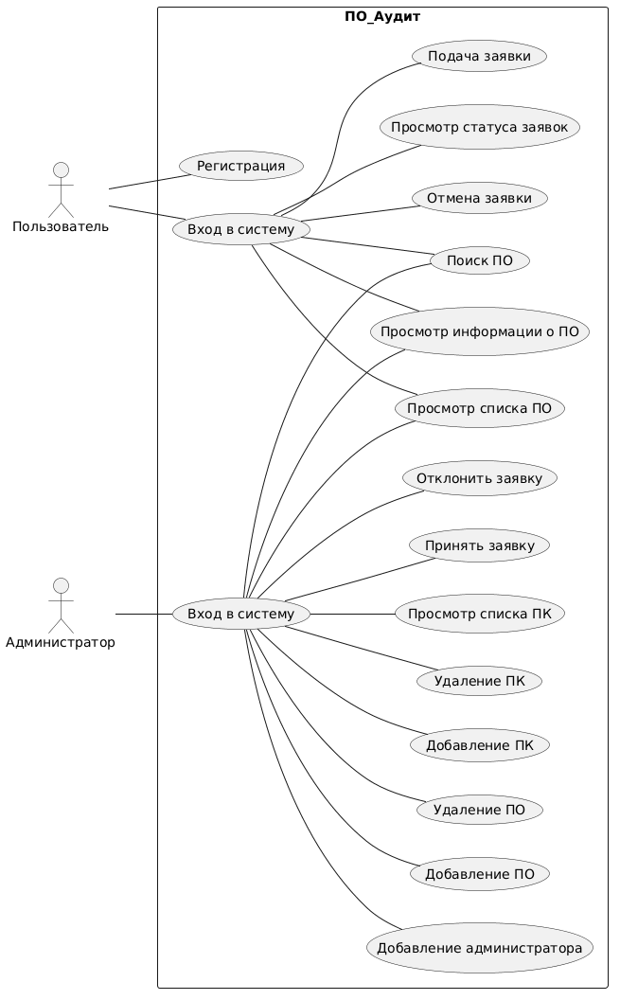
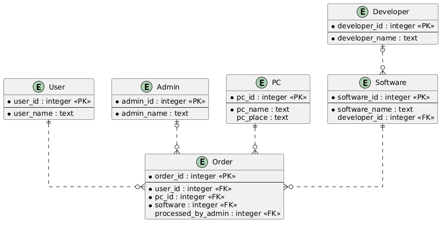

# PoAudit
PoAudit — консольное приложение для учета ПО в учебном классе. Проект предназначен для автоматизации основных процессов работы с учетом ПО в учебном классе.
Приложение позволяет регистрировать пользователей, выполнять авторизацию и работать с данными о ПО, пользователях и т.д.

## Возможности

В проекте реализованы следующие основные возможности:

*	Добавление ПО (ввод названия, информации о производителе и другой информации).
*	Поиск ПО (поиск нужного ПО в каталоге).
*	Просмотр информации о ПО и производителе.
*	Авторизация в системе
*	Установка ПО (оформление заявки на установку выбранного ПО на нужном компьютере).
*	Изменение и удаление данных о ПО и производителе.

    
## Структура проекта

```text
Poaudit/
│
├── docs/                       # Документация проекта
│   └── UseCase.plantuml        # Диаграмма вариантов использования
│   └── ER.plantuml             # Диаграмма сузность-связь
│   └── UseCase.png             # Диаграмма вариантов использования
│   └── ER.png                  # Диаграмма сущность-связь
│
├── src/                        # Исходный код приложения
│   │
│   └── poaudit/
│   │   └── main.py             # Точка входа в приложение
│   └── database                # Схема БД
│
│
├── .gitignore                  # Исключения для Git
└──  README.md                   # Документация проекта
```

## Архитектура

Приложение построено с использованием многослойной архитектуры.

```text
Пользователь
     │
     ▼
Консольный интерфейс
(main.py, menu.py, auth.py)
     │
     ▼
Сервисный слой
(services)
     │
     ▼
Слой доступа к данным
(repositories)
     │
     ▼
База данных
(database)
```

Такое разделение позволяет отделить пользовательский интерфейс от бизнес-логики и операций с данными.

### UseCase-диаграмма



### ER-диаграмма



### Основные компоненты

#### `main.py`

Точка входа в приложение. Выполняет инициализацию необходимых компонентов и запускает программу.

#### `menu.py`

Содержит логику взаимодействия с пользователем через консольное меню.

#### `auth.py`

Отвечает за регистрацию и авторизацию пользователей.

#### `models`

Содержит модели основных сущностей предметной области, включая пользователей, книги, авторов и бронирования.

#### `repositories`

Содержит компоненты, отвечающие за получение, добавление, изменение и удаление данных.

#### `services`

Содержит бизнес-логику приложения и обеспечивает взаимодействие между пользовательским интерфейсом и слоем доступа к данным.

#### `database`

Содержит компоненты, необходимые для работы с базой данных и её инициализации.

## Требования

Для запуска проекта необходимо установить:

* Python 3.13 или выше;
* Git.

## Установка

### 1. Клонирование репозитория

```bash
git clone https://github.com/h3gem
cd Poaudit
```


## Лицензия

Проект является учебным проектом. Условия использования могут быть определены в файле `LICENSE`.
